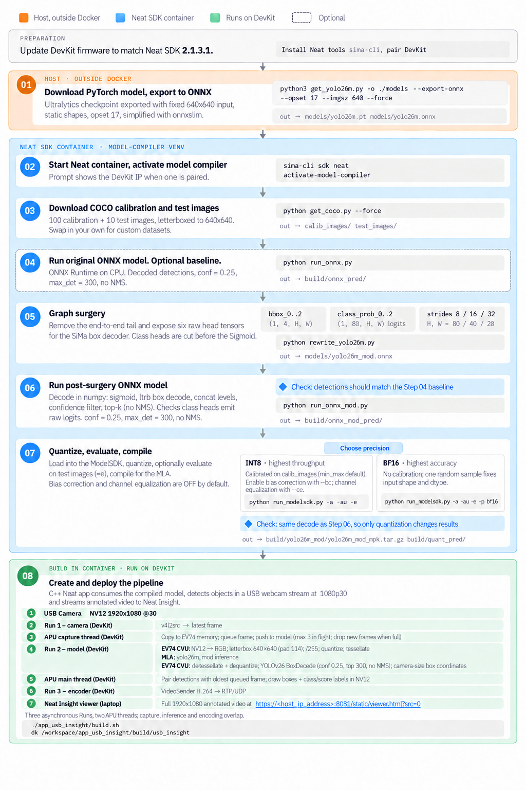
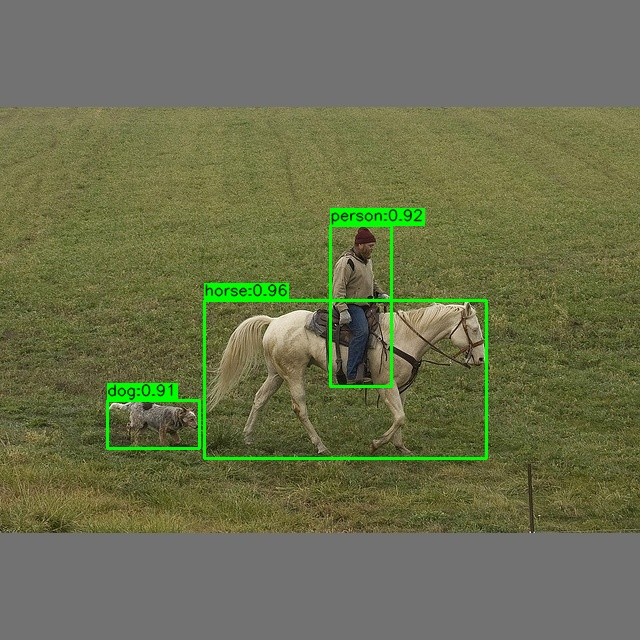
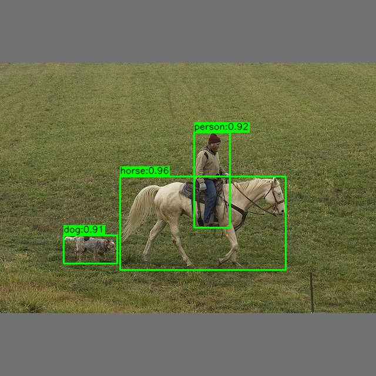
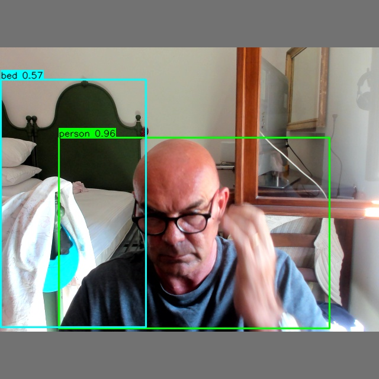
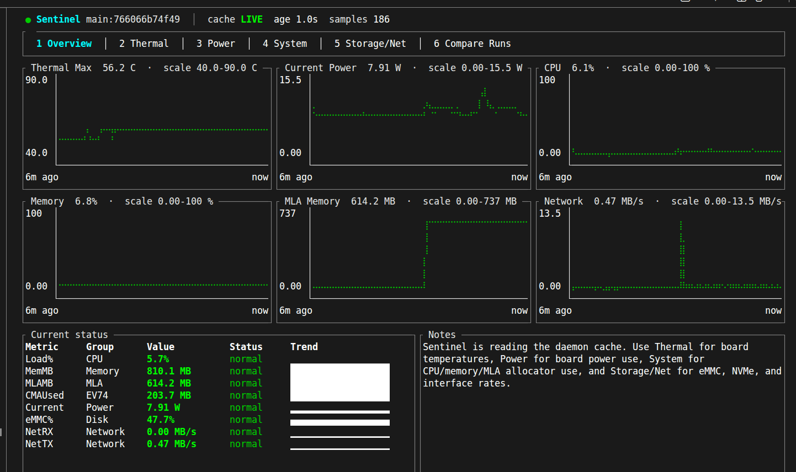

# Yolov26m example

End-to-end example of running the COCO-trained YOLO26m detector on a SiMa.ai Modalix DevKit.
The stock ONNX export is rewritten to expose the six raw detection-head tensors, then quantized and
compiled with the ModelSDK so box decoding runs on the hardware BoxDecode rather than inside the graph.

## Software and hardware used in this example

- SiMa.ai Modalix DevKit — Modalix SoM board (aarch64), with the MLA accelerator for inference and the EV74 CVU for preprocessing and box decoding.
- DevKit platform firmware / system image: `2.1.3_master_B4837`, built on 2026-08-19; eLxr 12 (aria), Linux kernel `6.18.3-modalix`.
- SiMa Neat SDK: `2.1.3.1`, using Docker image `ghcr.io/sima-neat/sdk:v2.1.3.1` for the development and cross-compilation environment.
- SiMa ModelSDK (Model Compiler): `2.1.3` (`2.1.3.dev0+master.393`), used to quantize, evaluate, and compile the YOLO26m model.
- SiMa Neat runtime and GStreamer plugins: `0.5.0` on the DevKit and in the SDK sysroot, used to run the preprocessing, inference, and detection-decoding pipeline.
- Neat EV74 CVU firmware package: `0.5.0` (`neat-ev74-firmware`).
- Neat Insight: `0.0.8`, bundled with Neat SDK `2.1.3.1`, used to view the annotated video the C++ Neat application streams to the host.
- USB camera: Logitech BRIO 4K Stream Edition on the DevKit (`/dev/video96`).


## Files in this repository

### Python scripts

| Script | Step | Interpreter | Description |
| --- | --- | --- | --- |
| `get_yolo26m.py` | #1 | host | Download the COCO-trained `.pt` checkpoint and export it to ONNX via Ultralytics, slimmed with onnxslim. |
| `get_coco.py` | #3 | Model SDK venv | Download COCO samples and letterbox them to 640x640 into `./calib_images` and `./test_images`. |
| `run_onnx.py` | #4 | Model SDK venv | Run the stock end-to-end export over `./test_images` with onnxruntime. The floating-point reference everything later is compared against. Generated by the coding agent from `run_onnx_prompt.md`. |
| `rewrite_yolo26m.py` | #5 | Model SDK venv | Cut the end-to-end tail off the export and expose the raw per-level `bbox_0..2` / `class_prob_0..2` head tensors that Neat's `BoxDecode` expects. |
| `run_onnx_mod.py` | #6 | Model SDK venv | Run the post-surgery model and decode the head tensors in numpy, reproducing what `BoxDecode` does on the target. Shares its preprocessing and output helpers with `run_onnx.py` through `utils.py`. Generated by the coding agent from `run_onnx_mod_prompt.md`. |
| `run_modelsdk.py` | #7 | Model SDK venv | Quantize (INT8 or BF16), optionally evaluate on the test frames, and compile for the MLA. Generated by the coding agent from `run_modelsdk_prompt.md` and the `agent_skills` template. |
| `utils.py` | #4, #6, #7 | Model SDK venv | The COCO class names, image listing, output-folder preparation, Ultralytics letterbox, NCHW preprocessing for the ONNX scripts, mapping boxes back through the letterbox, box drawing and PNG writing, shared so the ONNX references and the Model SDK script cannot drift apart. Decoding is deliberately not here: each model variant needs its own. |

"Model SDK venv" means `/sdk-extensions/model-compiler/bin/python3` inside the
Neat SDK container - what `activate-model-compiler` puts on the path - not the
container's default `python3`. See STEP #2.

### Agentic AI prompts

| Prompt | Description |
| --- | --- |
| `CLAUDE.md` | Project-wide instructions every prompt below defers to: model, image, results, compiled-model and application paths, the container and its `model-compiler` venv, the skills files inside the container, the Modalix target and the paired DevKit, preprocessing (BGR to RGB, Ultralytics letterbox with 114 padding when sizes differ, /255), BoxDecode-style post-processing (raw logits, conf=0.25, max_det=300, no NMS), NCHW/NHWC layouts, annotation style, PNG output, and the `staged_devkit.md` rule for anything staged on the DevKit. |
| `run_onnx_prompt.md` | Specification for `run_onnx.py`: ONNX inference of the original model (STEP #4). |
| `run_onnx_mod_prompt.md` | Specification for `run_onnx_mod.py`: ONNX inference of the post-surgery model with the box decode done in numpy (STEP #6). |
| `run_modelsdk_prompt.md` | Specification for `run_modelsdk.py`: quantize, evaluate and compile with the SiMa.ai Model SDK (STEP #7). It also points the agent at `agent_skills/SKILL.md`, which wins on conflicts. |
| `agent_skills/SKILL.md` | Model SDK skill: build the script from `assets/template.py` (header copied verbatim), copy helpers from `assets/utilities.py` rather than importing them, use `assets/preproc_lib.py` as a guide for preprocessing written into the script, stop and ask if pre- or post-processing is unspecified, add type hints and docstrings, evaluate with `.execute(..., fast_mode=True)`. |
| `usb_insight_prompt.md` | Specification for the C++ Neat application in `./app_usb_insight`: USB camera in, annotated H.264 out to Neat Insight (STEP #8). Its first step writes `camera_capabilities.md`. |

### Generated reports

Generated by the coding agent during the flow. `camera_capabilities.md` is not committed (it is in
`.gitignore`); `staged_devkit.md` is committed:

| File | Description |
| --- | --- |
| `camera_capabilities.md` | Every format, resolution and frame rate the USB camera supports, queried on the DevKit with `v4l2-ctl` (STEP #8). |
| `staged_devkit.md` | Modules, libraries, packages or GStreamer plugins staged on the DevKit. None are needed by this example. |





## Preparation

Refer to the SiMa [Developer Center](https://developer.sima.ai/) and read it carefully before starting.

### Devkit preparation

Update the devkit to the firmware release that matches the SDK version used here,
following the SiMa.ai [firmware update instructions](https://developer.sima.ai/hardware/getting-started/firmware-update).
A mismatch between the devkit firmware and the SDK may cause the compiled model to fail to load on the target.

### Install the Neat tools

Follow the SiMa.ai [development environment setup guide](https://developer.sima.ai/software/getting-started/dev-environment/)
to install the Neat tools (`sima-cli`) and to set up and pair the devkit.
The rest of this example assumes that guide has been completed and that the devkit is reachable.

Note: All steps are driven from the host machine, not the devkit. Step #1 is run outside the Neat docker;
Steps #2 - #8 are run from inside it (STEP #8 reaches the paired devkit with `dk`).


## STEP 1: Download trained Yolov26m PyTorch model and convert to ONNX

The COCO-trained YOLO26m checkpoint is downloaded from the Ultralytics GitHub
releases as a PyTorch `.pt` file, then exported to ONNX with the settings the
SiMa tools expect: a fixed 640x640 input, static shapes, and simplification with
onnxslim. Both files are written to `./models`, giving `yolo26m.pt` and the
`yolo26m.onnx` that every later step works from.

Requires Ultralytics package to be installed (pip install ultralytics onnx onnxslim)
Execute *outside* the Neat docker container.

Note how the ONNX opset is set to 17, this is the opset expected by the SiMa tools used in this example (SDK 2.1.3).

```shell
$ python3 get_yolo26m.py -o ./models --export-onnx --opset 17 --imgsz 640 --force
```


## STEP 2: Start Neat container and activate model compiler

Access the Neat docker container:

```shell
$ sima-cli sdk neat
```

If a devkit is paired with the host machine, the prompt will appear like this with the devkit IP address:

```shell
[DevKit 192.168.1.20:/workspace] user@neat-sdk-v2.1.3.1:/workspace$
```

If no devkit is paired, then the prompt will appear like this:

```shell
user@neat-sdk-v2.1.3.1:/workspace$
```


Activate the model compiler environment like this:

```shell
[DevKit 192.168.1.20:/workspace] user@neat-sdk-v2.1.3.1:/workspace$ activate-model-compiler
```


## STEP 3: Download sample COCO images for calibration and test

100 images for calibration and 10 images for test are downloaded then resized and padded to be 640x640.

For custom datasets, add approximately 100 representative images to a folder named ./calib_images and approximately 10 images to a folder named ./test_images. Images that are not 640x640 are letterboxed to 640x640 by the scripts in STEP #4, #6 and #7.

```shell
(model-compiler) [DevKit 192.168.1.20:/workspace] user@neat-sdk-v2.1.3.1:/workspace$ python get_coco.py --force
```


## STEP 4: Run ONNX inference of original ONNX model

This step is optional, but it is recommended to test the original ONNX model to produce baseline results.

`run_onnx.py` is generated by giving `run_onnx_prompt.md` to the coding agent, which also reads
`CLAUDE.md` for the paths, preprocessing, post-processing and output format.

Each image in ./test_images is converted to RGB, letterboxed only if it is not already 640x640, scaled
by 1/255 and run through the original ONNX model with ONNX Runtime on the CPU.
The YOLO26 graph is end-to-end, so it emits already-decoded and sorted detections. A copy of each
image annotated with the bounding boxes, class names and scores is written as a PNG to ./build/onnx_pred.


```shell
(model-compiler) [DevKit 192.168.1.20:/workspace] user@neat-sdk-v2.1.3.1:/workspace$ python run_onnx.py
```


## STEP 5: Graph Surgery

The original ONNX graph will be modified to make it compatible with the Sima box decoder.

The end-to-end tail of the graph - the reshape, concatenate, activate and detection-selection nodes -
is removed, and the six raw detection-head tensors are exposed as the model outputs instead: bbox_0..2
(1,4,H,W) and class_prob_0..2 (1,80,H,W) for strides 8/16/32, with H,W of 80/40/20. The class heads are
cut before the Sigmoid, since the Sima box decoder applies its own score activation and logits quantize
better. Any node no longer feeding an output is pruned, and the result is written to ./models/yolo26m_mod.onnx.


```shell
(model-compiler) [DevKit 192.168.1.20:/workspace] user@neat-sdk-v2.1.3.1:/workspace$ python rewrite_yolo26m.py
```


## STEP 6: Run ONNX inference of post-surgery model

Confirm that the post-surgery model gives the same results as the original model.

`run_onnx_mod.py` is generated from `run_onnx_mod_prompt.md` in the same way as STEP #4.

The same ./test_images are run through ./models/yolo26m_mod.onnx, but the decoding the graph used to do
now happens in numpy, following the host BoxDecode-style reference decode in the Neat SDK
(`tools/yolo26_compare_onnx_decode.py`) without its NMS: a sigmoid on the class logits, every
(grid cell, class) pair above the confidence threshold kept, an ltrb distance decode of the boxes around
each (cell + 0.5) * stride, the three levels concatenated, then a top-k of max_det by score (no NMS - the
head is NMS-free). Boxes are mapped back through the letterbox and clipped to the image. Detection counts
are printed per image and the annotated images are written to ./build/onnx_mod_pred. They should match
the STEP 4 baseline in ./build/onnx_pred - on the 10 test images the annotated PNGs are pixel-identical,
the classes are identical, and boxes and scores agree to within 1e-4.

The decode applies its own sigmoid, so the class heads must emit raw logits: in yolo26m_mod.onnx every
`class_prob_*` output is produced directly by a Conv, with no Sigmoid or Softmax after it.

```shell
(model-compiler) [DevKit 192.168.1.20:/workspace] user@neat-sdk-v2.1.3.1:/workspace$ python run_onnx_mod.py
```




## STEP 7: Quantize, Evaluate, Compile the post-surgery model

*Note: This step may take some time to run*

`run_modelsdk.py` is generated from `run_modelsdk_prompt.md`, following the template in
`agent_skills/assets/template.py`.

The post-surgery ONNX model is loaded into the Model SDK and quantized to INT8 or BF16 (-p, INT8 by
default), then compiled for Modalix. INT8 is calibrated on the 100 images in ./calib_images - min_max by
default, -cm selects another method. Bias correction (-bc) and channel equalization (-ce) are off by
default. BF16 needs no calibration and uses a single random sample only to fix the input shape and
dtype. No quantization error analysis is run.

With -e the quantized model is also evaluated on ./test_images with `.execute()`, decoding the six NHWC
head outputs in numpy the same way run_onnx_mod.py does - the same sigmoid, per-class confidence
filter, ltrb distance decode and top-k cap, and no NMS - so the only thing that moves between STEP #6
and STEP #7 is the quantization itself. With BF16 the detection counts on the 10 test images match the
float model exactly. With INT8 the counts differ on 3 of the 10 images, because some lower-confidence
detections cross the 0.25 threshold: in 000000427655 a person drops from 0.62 to 0.17 and a truck from
0.27 to 0.21, in 000000562581 a sports ball drops from 0.40 to 0.06, and in 000000260925 a small
distant person rises from 0.06 to 0.28.

-a (any shape on MLA) and -au (automatic layout conversion) are passed to the Model SDK `quantize()`
call. With them the compiled yolo26m_mod_mpk.tar.gz contains a single MLA `.elf`.

The quantized and compiled artifacts land in ./build/yolo26m_mod - including the yolo26m_mod_mpk.tar.gz
that the C++ Neat application consumes - and, with -e, the annotated evaluation images are
written as PNGs to ./build/quant_pred. Each folder is deleted and recreated when the script writes to it.


INT8-only quantization for highest throughput:

```shell
(model-compiler) [DevKit 192.168.1.20:/workspace] user@neat-sdk-v2.1.3.1:/workspace$ python run_modelsdk.py -a -au -e
```


..or BF16 quantization for highest accuracy

```shell
(model-compiler) [DevKit 192.168.1.20:/workspace] user@neat-sdk-v2.1.3.1:/workspace$ python run_modelsdk.py -a -au -e -p bf16
```





## STEP 8: Create and deploy a pipeline.

The C++ Neat application in `./app_usb_insight` consumes the `yolo26m_mod_mpk.tar.gz` built in
STEP #7 and runs on the paired DevKit: it detects objects in the USB webcam stream, draws the boxes
onto the frame, and streams the result to Neat Insight in a browser on the laptop. It was written
from `usb_insight_prompt.md`, whose first step queries the camera and writes `camera_capabilities.md`.

```
USB BRIO  /dev/video96  NV12 1920x1080 @30
     |
Run 1 "camera"     v4l2src --> Output("frame", latest only)
     |
APU capture thread copy frame to EV74 memory, queue it, push to the model (max 3 in flight)
     |
Run 2 "model"      EV74 CVU   NV12 -> RGB, letterbox 640x640 (pad 114), /255, quantize INT8, tessellate
     |             MLA        yolo26m_mod inference
     |             EV74 CVU   detessellate + dequantize, YOLOv26 BoxDecode (conf 0.25, top 300, no NMS)
     |
APU main thread    pair detections with the oldest queued frame, draw boxes + labels into NV12 Y/UV
     |
Run 3 "encoder"    Input("annotated") --> VideoSender: Neat H.264 encoder --> RTP/UDP --> Insight
```

Three asynchronous `Run`s - camera capture, detection, and encode/send - connected by two APU threads.
The capture thread keeps feeding the model Run while the main thread annotates and encodes the
previous frames, so capture, inference and encoding overlap. The model Run keeps frames in order, so
each detection set is drawn on the frame it came from. If the model falls behind, the capture
thread drops new frames instead of letting latency build up.

Annotation happens **in NV12**, so no colour conversion runs on the APU: box coordinates and line
thickness are snapped to even values so every edge lands on a chroma sample, labels are drawn on the
Y plane only, and NV12 is the Neat encoder's native input. BoxDecode returns coordinates already in
camera-frame pixels, inverting the letterbox itself from the preprocess metadata, so no box rescaling
is needed either. Measured on the DevKit, the application holds the camera's 30 fps at 1080p.

Build it for ARM64 in the container, then run it on the DevKit:

```shell
[DevKit 192.168.1.20:/workspace] user@neat-sdk-v2.1.3.1:/workspace$ ./app_usb_insight/build.sh
[DevKit 192.168.1.20:/workspace] user@neat-sdk-v2.1.3.1:/workspace$ dk /workspace/app_usb_insight/build/usb_insight
```

Open the viewer on the laptop at `https://192.168.1.29:8081/static/viewer.html?src=0`. The
application streams until it is stopped; from another container shell use
`dk shell "pkill -INT -x usb_insight"`.



The full 1920x1080 camera frame is streamed - the boxes are drawn into the NV12 planes, so there is
no letterboxing or rescaling anywhere on the display path.

See `app_usb_insight/README.md` for the prerequisites, build and run details.


## On-baord telemetry with Sentinel

[Sentinel](https://developer.sima.ai/software/tools/sentinel/) is SiMa.ai's metrics collector for
the Modalix DevKit. A background daemon on the DevKit samples board thermal sensors, CPU load, Linux
and MLA allocator memory, disk usage and IO, network IO, and Modalix power draw over PMBus. The
`simaai-sentinel` CLI reads the daemon's cache and shows live tables and terminal graphs. It can also
record named checkpoints of workload runs so they can be compared later.

Install it on the DevKit itself, because the daemon reads the hardware sensors directly, then open
the terminal view:

```shell
sima-cli neat install sentinel
simaai-sentinel
```

The screenshot below shows the Overview page: thermal, power, CPU, memory, MLA memory and network
graphs above a table of current values.




